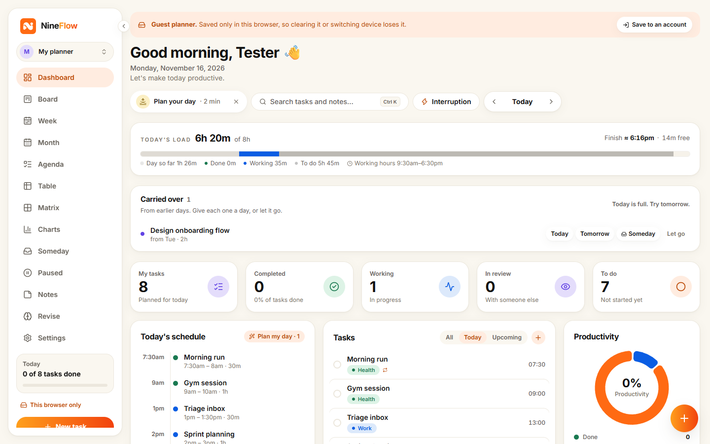
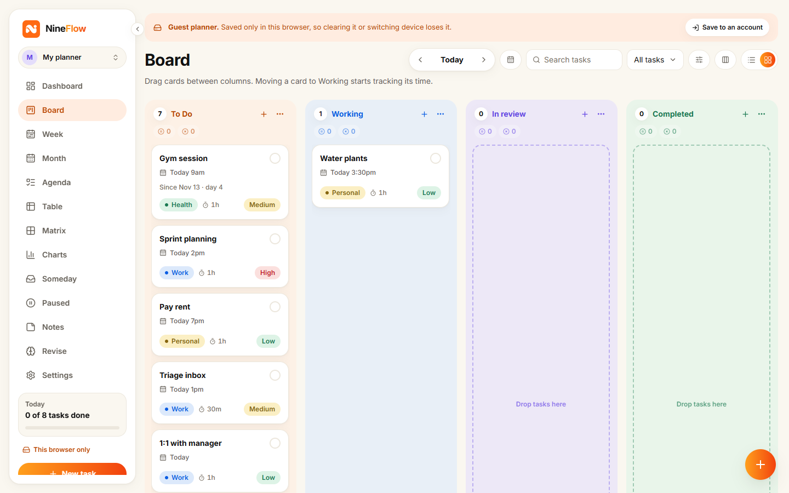
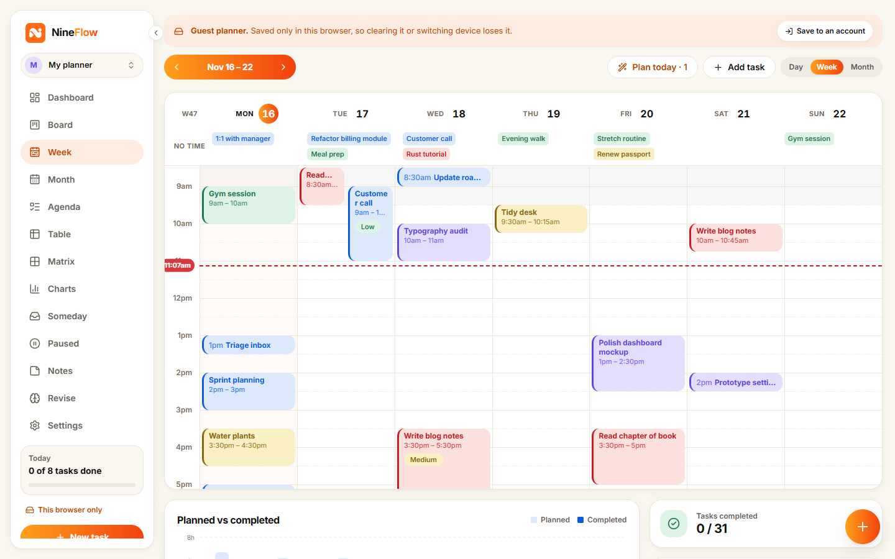
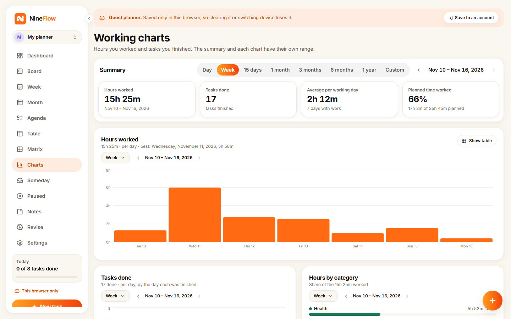
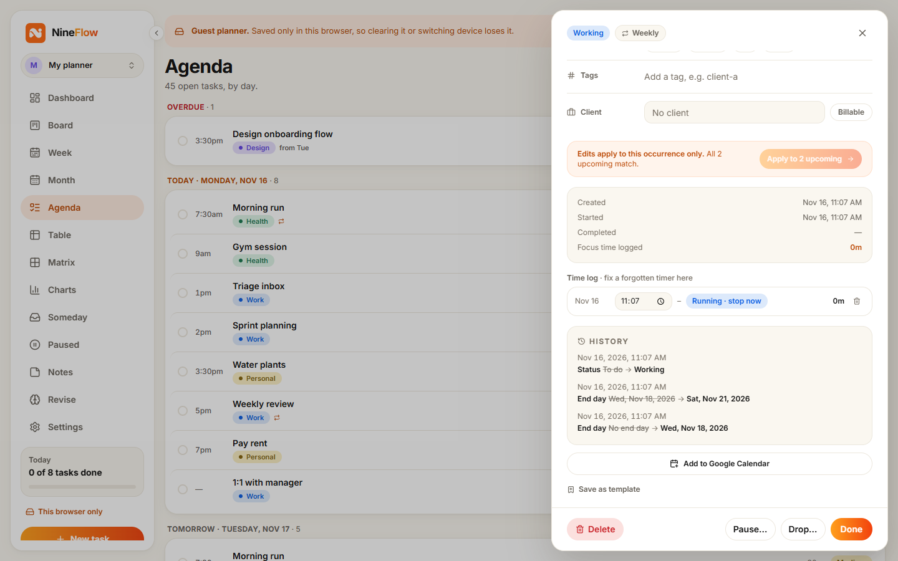
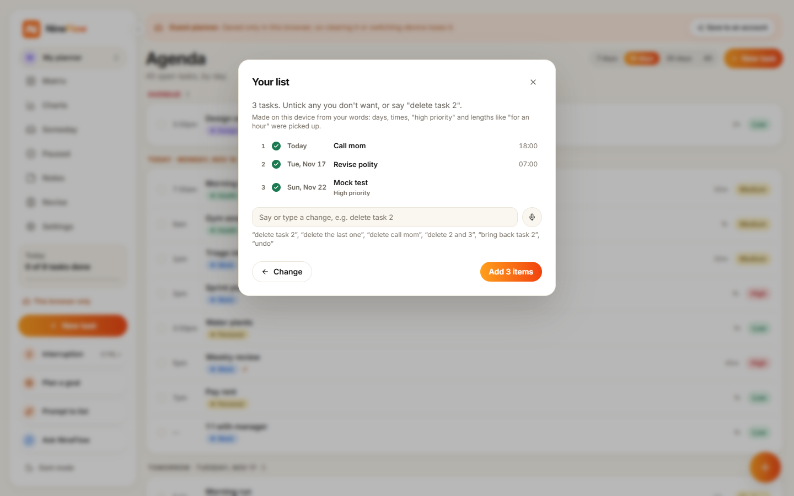
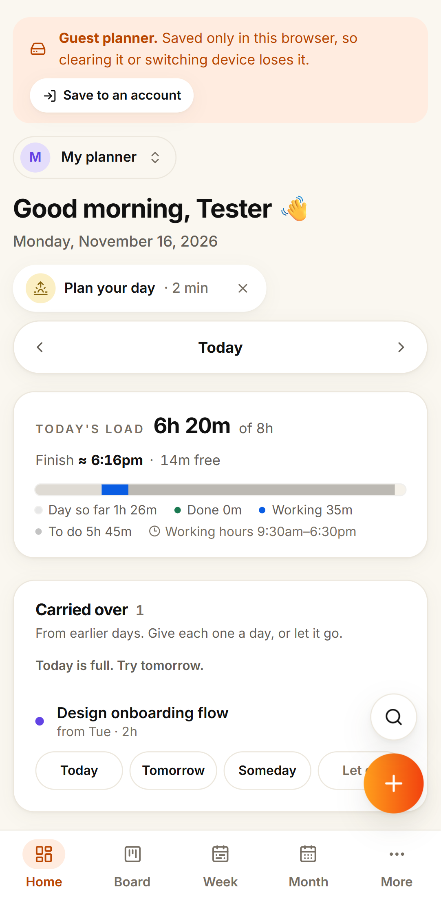

# NineFlow — plan better, flow forward

NineFlow is a daily planner, focus timer and work log in one app. It runs on the **web**, **Windows/Mac** (Electron) and **Android** (Capacitor) from a single React codebase, and it works offline.



> **Try it without signing up:** open the app, choose **"Try it without an account"**, and leave **"Start with sample data"** on. Six weeks of example tasks fill every screen, and nothing leaves your browser.

## What it does

**Plan the day**
- **Dashboard** with today's load (planned hours against your working hours), what was carried over from earlier days, and a time-blocked schedule
- **Board** with drag-and-drop columns (To do → Working → In review → Completed). Moving a card to Working starts its timer.
- **Week and Month calendars**, plus **Agenda**, **Table** (sort, filter, bulk edit) and an **Eisenhower matrix**
- **Someday** and **Paused** lists for work that has no day yet or is blocked, each with a reason

**Add work quickly**
- **Quick add** in plain words: `Call the bank tomorrow 3pm !high 30m #work` fills in the day, time, priority, length and category
- **Speak tasks**: say several tasks at once ("revise polity tomorrow at 7 **next** mock test on Sunday high priority"). Spoken changes like "delete that" or "remove task 2" work while dictating and on the preview list.
- **Prompt to list**: turn a messy note or meeting notes into tasks with AI (Claude), with a summary and the decisions. Nothing is added until you confirm.

**Track and improve**
- **Focus timer** (Pomodoro) that logs real working time on each task
- **Charts** for hours worked, tasks done, and hours by category or client over any range
- **Every change is recorded**: each task keeps a history of what changed, from what, to what, and when (end day, date, status, priority and more)
- Habits, notes with images, flashcard revision, and exam-prep planners (RRB NTPC, SSC, IBPS)

**Your data**
- Works **offline**. Sign in with **Google** (saved to your own Google Drive) or with email (Supabase), or use it as a guest.
- Reminders, Google Calendar sync, several workspaces, version history with restore, custom fields, themes

| Board | Week |
|---|---|
|  |  |

| Charts | A task's change history |
|---|---|
|  |  |

| Prompt to list | Phone |
|---|---|
|  |  |

## Tech stack

| Area | Built with |
|---|---|
| App | React 18, Vite, Tailwind CSS, date-fns, Recharts, dnd-kit, lucide icons |
| Desktop | Electron + electron-builder (signed Windows installer, macOS build workflow) |
| Android | Capacitor (native speech recognition, local notifications) |
| Accounts and sync | Google Identity + Google Drive API, Supabase (email accounts) |
| Server functions | Vercel serverless functions (`api/`): AI features with Claude, web push reminders, email-to-task |
| Testing | Playwright end-to-end tests (desktop and phone screens) and unit tests for the parsers |

## Run it locally

You need **Node.js 20.19 or newer** (or 22.12+).

```bash
git clone https://github.com/KartikeyanC/Nineflow.git
cd Nineflow
npm install
npm run dev
```

Open http://localhost:5173 and choose **"Try it without an account"**. Guest mode needs no keys.

Optional: to turn on Google sign-in, email accounts or the AI features, copy `.env.example` to `.env.local` and fill in your own keys. See [docs/GOOGLE_SETUP.md](docs/GOOGLE_SETUP.md) and [docs/SUPABASE_SETUP.md](docs/SUPABASE_SETUP.md).

| Command | What it does |
|---|---|
| `npm run dev` | Start the web app for development |
| `npm run build` | Production build into `dist/` |
| `npm run desktop` | Open the desktop (Electron) app |
| `npm run desktop:win` | Build the Windows installer |
| `npm run android:build` | Build the Android APK ([docs/MOBILE.md](docs/MOBILE.md)) |
| `npm run test:e2e` | End-to-end tests in Chrome, on desktop and phone screen sizes |
| `npm run test:voice` / `test:history` / `test:fields` | Unit tests for voice commands, change history and custom fields |

## Project layout

```
src/
  views/        Dashboard, Board, Week, Month, Agenda, Table, Matrix, Charts, Notes...
  components/   Task panel, date and time pickers, Prompt to list, shared UI
  features/     Sign-in, sync, reminders, workspaces, version history
  lib/          Parsers (quick add, voice), task logic, change history, storage
  store/        Planner state (React context)
  exams/        Exam-prep planners
  work/         Work OS: daily reports, task log, time plans
api/            Serverless functions (AI, push reminders, email inbox)
desktop/        Electron main process and Google sign-in for desktop
android/        Capacitor Android project
e2e/            Playwright tests
docs/           Setup guides
```

## Licence

Copyright © 2026 Kartikeyan. All rights reserved. The code is shared here so it can be viewed. See [LICENSE](LICENSE).
